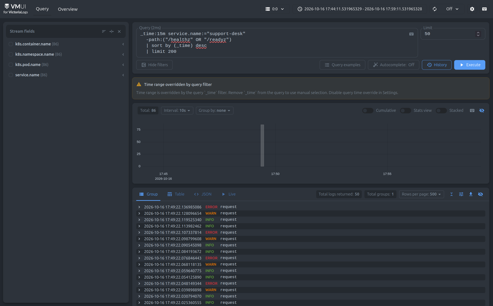
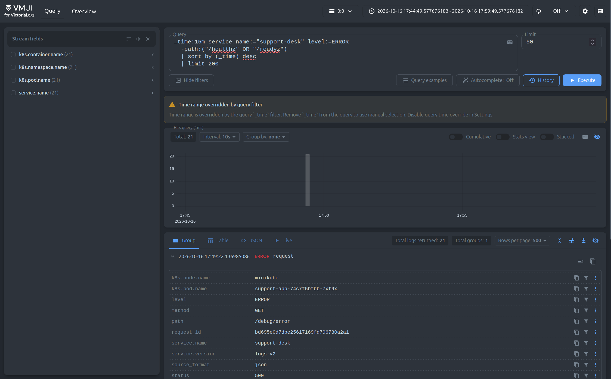
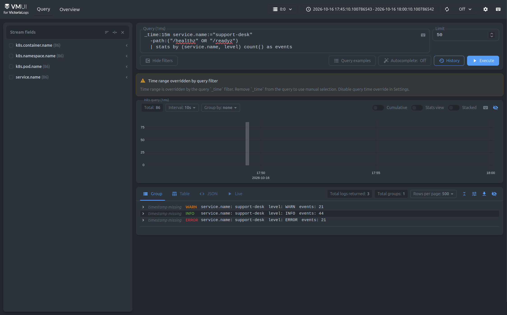
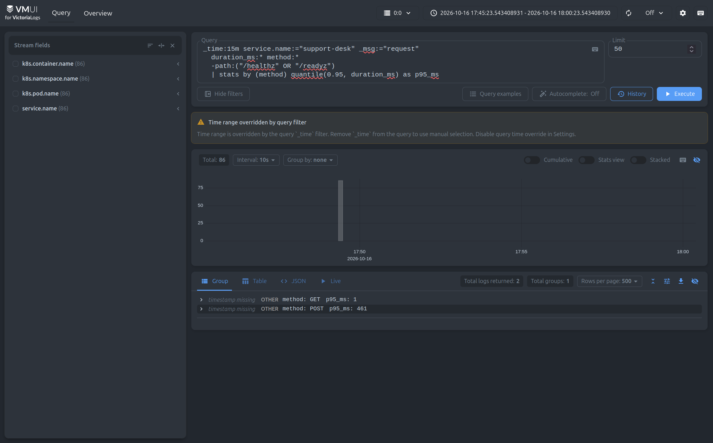
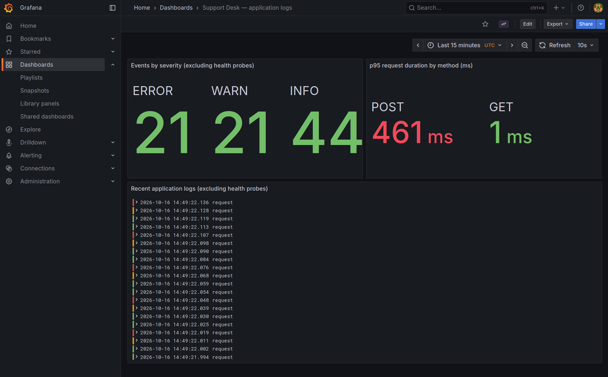

# Сбор и анализ логов

В Minikube-кластере развёрнуты VictoriaLogs single-node, Vector и Grafana с официальным плагином VictoriaLogs. Support
Desk и PostgreSQL работают в namespace `support-desk`, компоненты логирования - в `logging`.

Использованы обычные Kubernetes-манифесты.

## Компоненты и конфигурация

| Компонент          | Версия / настройка                                             |
|--------------------|----------------------------------------------------------------|
| Minikube           | 1.39.0, профиль `minikube`, Docker driver                      |
| Kubernetes         | 1.37.0, один узел, Docker 29.7.2                               |
| Приложение         | `support-desk:logs-v2`;                                        |
| VictoriaLogs       | `victoriametrics/victoria-logs:v1.52.0`, одна реплика          |
| Vector             | `timberio/vector:0.51.1-debian`, DaemonSet                     |
| Grafana            | `grafana/grafana:12.2.0`                                       |
| Официальный плагин | `victoriametrics-logs-datasource`, 0.32.0                      |
| Хранение логов     | PVC 2 GiB, StorageClass `standard`, retention 7 дней           |
| Буфер Vector       | Ограниченный дисковый буфер около 256 MiB; checkpoints на узле |

Манифесты находятся в [k8s/logging](../../k8s/logging/README.md). Для VictoriaLogs заданы Deployment со стратегией `Recreate`,
ClusterIP Service на порту 9428 и PVC. Grafana использует файлы provisioning для источника данных и дашборда. Пароль
администратора создаётся скриптом в Kubernetes Secret.

## Как устроена доставка

```text
JSON stdout Go/Gin и административных команд
  → файлы контейнерного runtime на узле
  → Vector DaemonSet: чтение, разбор JSON, добавление Kubernetes-полей
  → Elasticsearch Bulk API VictoriaLogs
  → vmui и Grafana

stdout/stderr PostgreSQL → тот же Vector → структурированная обёртка текстовых записей
```

DaemonSet выбран потому, что он собирает stdout всех реплик без сайдкара в каждом Pod и без зависимости Go-приложения от
API хранилища логов. Vector разбирает контейнерную обёртку Docker/CRI, затем JSON самого приложения. Для Docker в этом
Minikube нужны read-only монтирования `/var/log` и `/var/lib/docker/containers`: файлы Pod являются симлинками на Docker
JSON logs. Коллектор использует ServiceAccount с правами чтения метаданных Kubernetes.

Выбираются только `support-app`, `postgres`, `support-migrate` и `support-seed` в namespace `support-desk`. Собственные
логи Vector, VictoriaLogs и Grafana не попадают в этот конвейер. PostgreSQL продолжает писать свой текстовый формат:
Vector добавляет время runtime, `service.name=postgres`, сведения о Pod и распознанный уровень. Нераспознанный уровень
обозначается `UNKNOWN`. Поле `source_format` позволяет отличить JSON приложения от текстовых записей базы.

Конфигурация разбора и доставки: [vector-config.yaml](../../k8s/logging/vector-config.yaml). Checkpoints и буфер находятся на
узле, поэтому сохраняются при замене Pod коллектора. PVC сохраняет записи при замене Pod VictoriaLogs.

## Формат логов приложения

Каждая строка - JSON-объект с `timestamp` в UTC, `level`, `message`, `service.name`, `service.version`,
`deployment.environment.name` и `command`. HTTP-записи дополнительно содержат `request_id`, `method`, `path`, числовые
`status` и `duration_ms`. INFO используется для ответов до 400, WARN - для 4xx, ERROR - для 5xx. Для каждого запроса
создаётся одна access-запись; дополнительные диагностические события считаются отдельно.

Инициализация JSON-логгера происходит до проверки конфигурации. Goose использует адаптер того же логгера. Миграция и
seed имеют события `command started` и `command completed`. Тела запросов, query string, Cookie, Authorization, пароли и
приглашения в access-логи не записываются. Для неожиданных ошибок сохраняются тип и request ID, без сырого текста
драйвера, который может содержать приватные значения. Пользовательские panic payload и заголовки также не выводятся.

Пример предупреждающей записи stdout:

```json
{
  "timestamp": "2026-10-15T21:55:18.604185513Z",
  "level": "WARN",
  "message": "request",
  "service.name": "support-desk",
  "service.version": "logs-v1",
  "deployment.environment.name": "minikube",
  "command": "serve",
  "request_id": "0c6af4b923848e0dee18ebcbeaa18548",
  "method": "GET",
  "path": "/api/v1/tickets",
  "status": 401,
  "duration_ms": 0
}
```

При приёме `_time_field=timestamp`, `_msg_field=message`. Поля `service.name`, `k8s.namespace.name`, `k8s.pod.name` и
`k8s.container.name` образуют `_stream`. `request_id` остаётся обычным полем, а не меткой потока. В выдаче VictoriaLogs
время и сообщение представлены как `_time` и `_msg`; значения остальных полей в её JSON API обычно отображаются
строками, что не мешает числовым агрегатам LogsQL.

## Запросы в vmui

UI открывается по **http://localhost:9428/select/vmui/**. Путь `/vmui/` возвращал ошибку;
Запросы исключают запросы к healthcheck эндпоинтам, так как их было слишком много и они быстро вытесняли полезные логи

### 1. Сырые записи за последние 15 минут

```text
_time:15m service.name:="support-desk" -path:("/healthz" OR "/readyz") | sort by (_time) desc | limit 200
```

Показывает до 200 последних записей приложения за 15 минут, начиная с самых новых. Позволяет посмотреть отдельные
события и их поля: время, уровень, путь запроса, HTTP-статус и request ID.



### 2. Фильтр по полю уровня

```text
_time:15m service.name:="support-desk" level:=ERROR -path:("/healthz" OR "/readyz") | sort by (_time) desc | limit 200
```

Оставляет только записи уровня ERROR за последние 15 минут. В приложении это HTTP 500 от `/debug/error`. Фильтр помогает
быстро найти ошибки среди остальных событий.



### 3. Статистика с группировкой

```text
_time:15m service.name:="support-desk" -path:("/healthz" OR "/readyz") | stats by (service.name, level) count() as events
```

Считает записи за 15 минут с группировкой по сервису и уровню логирования. Показывает количество событий INFO, WARN
и ERROR без health checks.



### 4. Агрегация: p95 длительности по HTTP-методу

```text
_time:15m service.name:="support-desk" _msg:="request" duration_ms:* method:* -path:("/healthz" OR "/readyz") | stats by (method) quantile(0.95, duration_ms) as p95_ms
```

Оценивает 95-й перцентиль длительности HTTP-запросов в миллисекундах отдельно для каждого метода. Позволяет сравнить
задержки GET и POST; учитываются только access-записи с полями длительности и метода, без health checks.



## Grafana

Установлен официальный `victoriametrics-logs-datasource`. Provisioning настраивает адрес
`http://victoria-logs.logging.svc.cluster.local:9428` и дашборд **Support Desk - application logs** с UID
`support-logs`.

Панели показывают количество событий по уровням, p95 длительности по методам и последние записи приложения. Для
агрегатов используется тип запроса плагина `stats`, для сырых логов - `instant`. Данные получаются через плагин из
VictoriaLogs.


