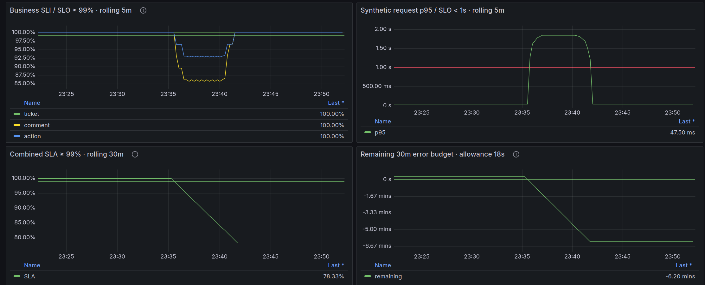
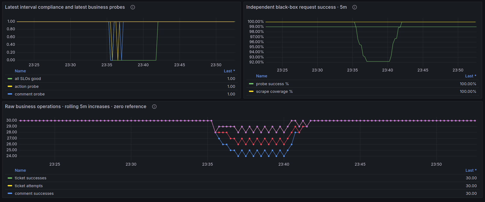

# SLI / SLO / SLA для Support Desk

## Сценарий и компоненты

Пробер выполняет через внутренний HTTP Service три пользовательских сценария:

1. пользователь создаёт обращение;
2. пользователь добавляет явный комментарий;
3. оператор переназначает обращение.

Каждый раунд запускается раз в 10 секунд. Запросы выполняются с отдельными учётными записями, после
успешной проверки временные обращения и комментарии удаляются. Три операции измеряются независимо: ошибка одного запроса
не отменяет остальные.

| Компонент                       | Версия / настройка                                             |
|---------------------------------|----------------------------------------------------------------|
| Minikube                        | профиль `minikube`, Docker driver                              |
| Kubernetes namespace приложения | `support-desk`                                                 |
| Support Desk                    | образ `support-desk:slo-v1`, Go, Gin                           |
| PostgreSQL                      | `postgres:18.0-alpine3.22`                                     |
| VictoriaMetrics                 | `victoriametrics/victoria-metrics:v1.154.0`, single-node       |
| Grafana                         | `grafana/grafana:12.2.0`                                       |
| Пробер                          | образ `support-prober:slo-v1`, Python 3.14 Alpine, порт `9115` |
| Интервал сбора                  | 15 секунд                                                      |
| Интервал синтетического раунда  | 10 секунд                                                      |

Приложение и пробер находятся в `support-desk`, VictoriaMetrics — в `monitoring`, Grafana и VictoriaLogs — в `logging`.
VictoriaMetrics обнаруживает Pod по Kubernetes service discovery и аннотациям Prometheus.

## Архитектура

```text
SLO prober → HTTP Service Support Desk :8080 → PostgreSQL

Support Desk /metrics :9090 ─┐
SLO prober /metrics :9115 ───┼→ VictoriaMetrics :8428 → Grafana
PostgreSQL exporter :9187 ───┘
```

В приложении `/healthz`, `/readyz` и `/metrics` не подвергаются сбоям. Fault injector применяется только
после аутентификации и валидации допустимой бизнес-операции, поэтому ошибки валидации и отказ в доступе не искажают
знаменатель SLI. Ошибки базы, таймауты и синтетические HTTP 503 учитываются как неуспешные попытки.

## Бизнес-метрики

| Метрика                                | Тип / метки            | Назначение                                             |
|----------------------------------------|------------------------|--------------------------------------------------------|
| `support_tickets_opened_total`         | Counter, `priority`    | Успешно сохранённые обращения после commit транзакции. |
| `support_ticket_open_attempts_total`   | Counter, `priority`    | Завершённые допустимые попытки создания обращения.     |
| `support_comments_added_total`         | Counter, `author_role` | Успешно добавленные явные комментарии.                 |
| `support_comment_add_attempts_total`   | Counter, `author_role` | Завершённые допустимые попытки добавления комментария. |
| `support_ticket_actions_total`         | Counter, `action`      | Успешно завершённые действия workflow.                 |
| `support_ticket_action_attempts_total` | Counter, `action`      | Завершённые допустимые попытки действий workflow.      |

Счётчик попытки увеличивается для операции, прошедшей проверку входных данных и прав. Успешный счётчик увеличивается
только после успешного сохранения и commit. Идентификаторы пользователей и обращений, email и тексты сообщений в метрики
не попадают.

Дополнительные метрики приложения и PostgreSQL из предыдущей работы продолжают собираться. Пробер экспортирует следующие
ряды на порту `9115`:

| Метрика                                      | Тип / метки            | Назначение                                                    |
|----------------------------------------------|------------------------|---------------------------------------------------------------|
| `support_probe_attempts_total`               | Counter, `operation`   | Все завершённые синтетические запросы.                        |
| `support_probe_successes_total`              | Counter, `operation`   | Успешные синтетические запросы.                               |
| `support_probe_success`                      | Gauge, `operation`     | Результат последней операции.                                 |
| `support_probe_duration_seconds`             | Histogram, `operation` | Сквозная длительность синтетического запроса, включая ошибки. |
| `support_probe_last_round_timestamp_seconds` | Gauge                  | Время последнего завершённого раунда.                         |

## Пробер

Пробер реализован в [scripts/slo-prober.py](../../scripts/slo-prober.py) и запускается
манифестом [k8s/slo/prober.yaml](../../k8s/slo/prober.yaml). Он использует стандартную библиотеку Python, не записывает
cookies, пароли и тела ответов, работает от непривилегированного пользователя и имеет только read-only файловую систему.

Состояние готовности пробера означает готовность процесса экспортировать метрики. Неуспешный бизнес-раунд сохраняется в
`support_probe_success` и не скрывается Kubernetes readiness-проверкой. Это позволяет отличать доступность экспортера от
качества пользовательского сценария.

## SLI

Для rolling-окна 5 минут используются отношения успешных операций к допустимым попыткам:

```text
TicketSLI = sum(increase(support_tickets_opened_total[5m]))
            / sum(increase(support_ticket_open_attempts_total[5m]))

CommentSLI = sum(increase(support_comments_added_total[5m]))
             / sum(increase(support_comment_add_attempts_total[5m]))

ActionSLI = sum(increase(support_ticket_actions_total[5m]))
            / sum(increase(support_ticket_action_attempts_total[5m]))
```

В рабочих запросах добавлены фильтр `job` и защита от пустого окна. Если допустимых попыток нет, панель показывает `0`,
а не 100% успеха. Формулы находятся в [docs/slo/queries.json](../slo/queries.json).

Четвёртый SLI — 95-й перцентиль длительности синтетических запросов:

```promql
histogram_quantile(
  0.95,
  sum by (le) (rate(support_probe_duration_seconds_bucket{job="slo-prober"}[5m]))
)
```

## SLO

Заданы следующие цели:

| SLI                        | Окно    | Цель            |
|----------------------------|---------|-----------------|
| Создание обращения         | 5 минут | не ниже 99%     |
| Добавление комментария     | 5 минут | не ниже 99%     |
| Действие workflow          | 5 минут | не ниже 99%     |
| Синтетическая задержка p95 | 5 минут | менее 1 секунды |

## SLA и error budget

Для time-based проверки используется фиксированная сетка с шагом 15 секунд. Интервал считается хорошим, если
одновременно выполнены все три бизнес-SLO, p95 меньше секунды, `up{job="support-desk"}` и `up{job="slo-prober"}` равны
1, последний раунд пробера не старше 45 секунд, а все три операции последнего раунда успешны.

Комбинированный SLA за 30 минут рассчитывается как доля хороших интервалов:

```promql
100 * avg_over_time(good_interval[30m:15s])
```

Здесь `good_interval` — сокращённое обозначение выражения `good` из [docs/slo/queries.json](../slo/queries.json).

Цель SLA — 99%. Допустимый error budget равен 1% от 30 минут = 18 секунд. Один плохой 15-секундный интервал
расходует большую часть бюджета. Отсутствующие или устаревшие наблюдения считаются плохими интервалами.

```text
budget_remaining_seconds = 18 - 1800 * (1 - SLA_percent / 100)
```

Отрицательный остаток означает превышение бюджета. Панель покрытия показывает заполнение 30-минутного окна; до его
заполнения значение SLA не подтверждает полный здоровый baseline.

## Grafana

В существующий Grafana через provisioning добавлены источник VictoriaMetrics с UID `victoriametrics` и дашборд **Support
Desk — SLI / SLO / SLA** с UID `support-slo`. Источник обращается к
`http://victoria-metrics.monitoring.svc.cluster.local:8428`. Дашборд обновляется каждые 15 секунд и содержит панели:

- три бизнес-SLI с порогом 99% за 5 минут;
- synthetic p95 с порогом 1 секунда;
- комбинированный SLA за 30 минут;
- оставшийся error budget;
- результат каждой из трёх синтетических операций;
- число попыток и долю успешных запросов пробера.

Пороговые линии отображаются во всех панелях: 99% для долей успеха и SLA, 1 секунда для p95, 0 секунд для остатка error
budget, 1 для полного good-интервала и нулевая диагностическая линия для raw-счётчиков.

Исходный JSON дашборда: [docs/slo/dashboard.json](../slo/dashboard.json). Kubernetes ConfigMap для
provisioning: [k8s/slo/grafana-dashboard.yaml](../../k8s/slo/grafana-dashboard.yaml). Существующий datasource VictoriaLogs и
log dashboard сохраняются.




## Развёртывание

Сборка образов и развёртывание выполняются командами:

```sh
docker build --build-arg VERSION=slo-v1 -t support-desk:slo-v1 .
docker build -f scripts/Dockerfile.prober -t support-prober:slo-v1 .
minikube image load support-desk:slo-v1 support-prober:slo-v1
./k8s/slo/deploy.sh
```

Скрипт применяет приложение, PostgreSQL, VictoriaMetrics, logging stack, пробер и Grafana provisioning. Для доступа к UI
используются отдельные port-forward:

```sh
kubectl --context=minikube -n logging port-forward service/grafana 13000:3000
kubectl --context=minikube -n monitoring port-forward service/victoria-metrics 8428:8428
```

Дашборд Grafana загружен и доступен по адресу `http://localhost:13000/d/support-slo` после запуска port-forward.

## Демо

Сбой включается командой:

```sh
./k8s/slo/faults.sh on
# LAB_FAULT_RATE=0.20, LAB_FAULT_DELAY=1.5s
```

Текущий результат пробера восстанавливается первым. Rolling SLI продолжает учитывать плохие наблюдения до пяти минут, а
SLA — до выхода плохих 15-секундных интервалов из 30-минутного окна. 
