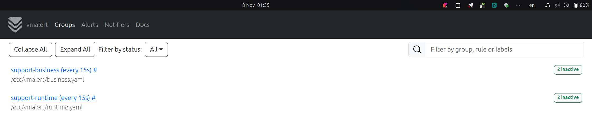
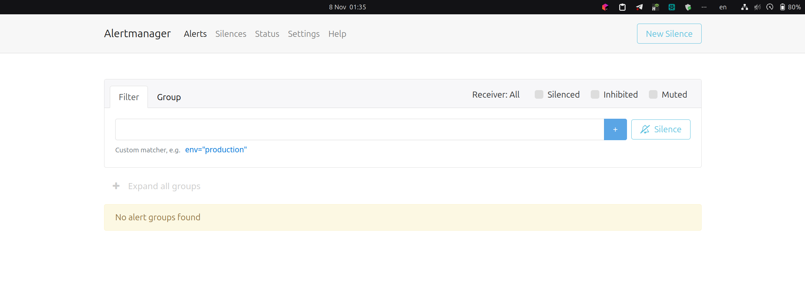
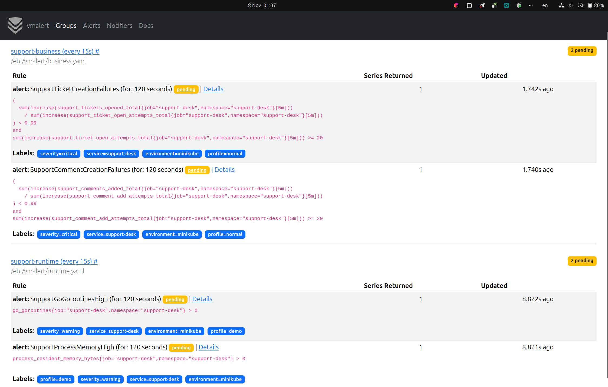
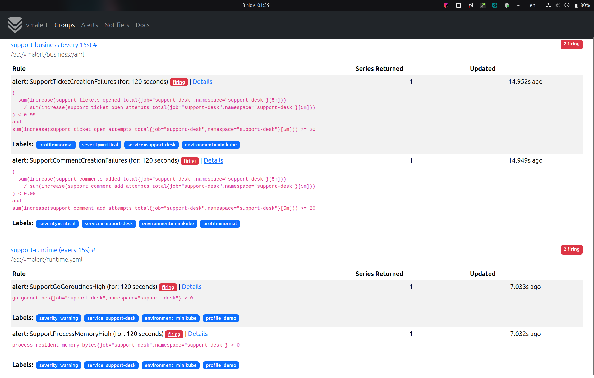
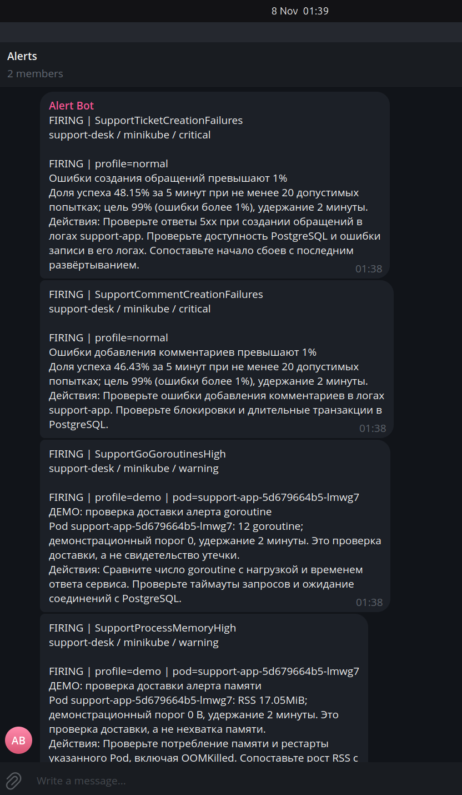
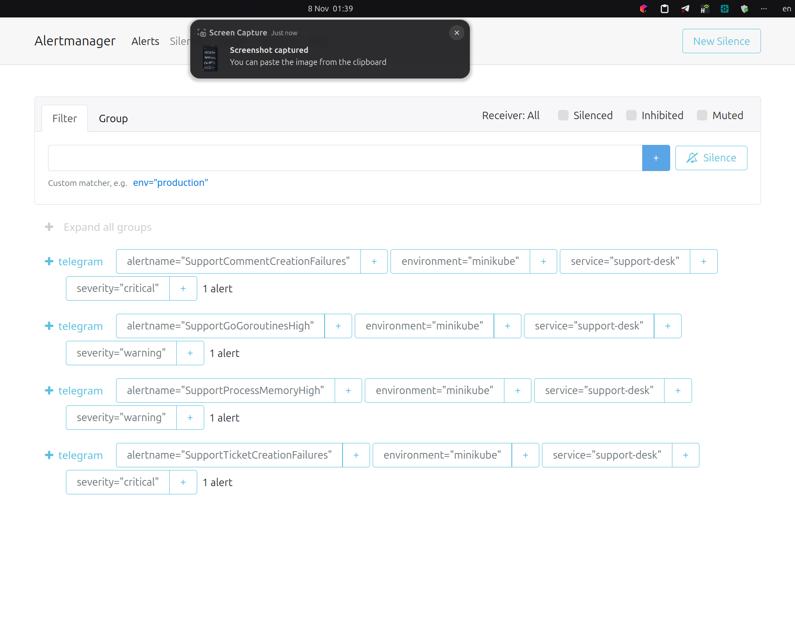
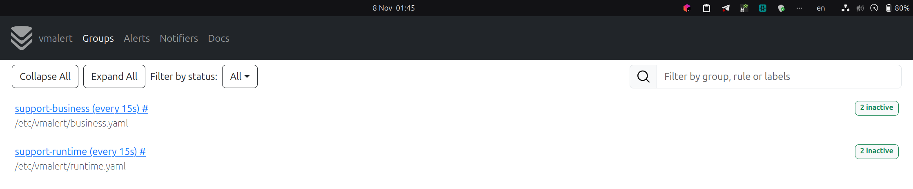
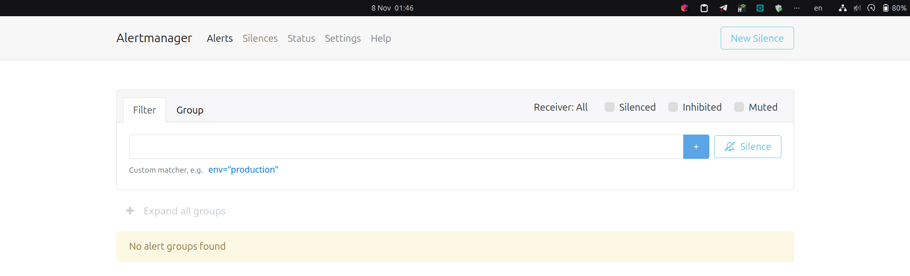
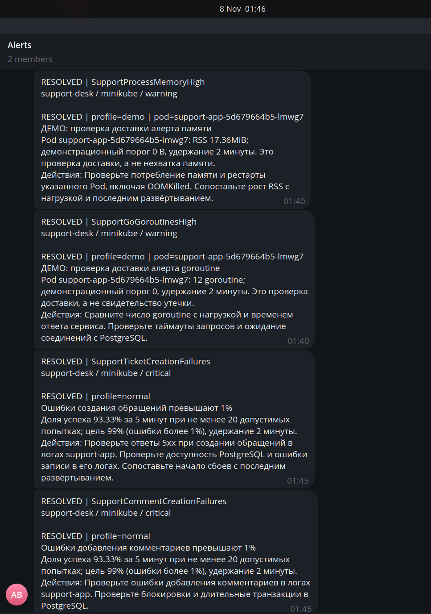

# Алертинг Support Desk

VictoriaMetrics собирает метрики Go/Gin-приложения каждые 15 секунд. vmalert с тем же
интервалом вычисляет четыре правила и отправляет их в Alertmanager, который доставляет
уведомления в Telegram. Метрики Go/process collectors используются как runtime метрики

```text
Support Desk → VictoriaMetrics → vmalert → Alertmanager → Telegram
```

## Правила

| Алерт                            | Условие в течение 2 минут                                         | Причина                                  |
|----------------------------------|-------------------------------------------------------------------|------------------------------------------|
| `SupportTicketCreationFailures`  | Успех создания обращений <99% за 5 минут, минимум 20 попыток      | Нарушение SLO основной функции           |
| `SupportCommentCreationFailures` | Успех добавления комментариев <99% за 5 минут, минимум 20 попыток | Нарушение общения с оператором           |
| `SupportGoGoroutinesHigh`        | Более 100 goroutine на экземпляре                                 | Возможное накопление запросов или утечка |
| `SupportProcessMemoryHigh`       | RSS процесса >200 MiB при лимите контейнера 256 MiB               | Предупреждение о росте памяти            |

Для бизнес-правил делится сумма `increase` успешных операций на сумму `increase`
допустимых попыток. Вычисление increase до суммирования учитывает рестарты реплик.
Клиентские ошибки 4xx исключены из попыток; отсутствие трафика не вызывает алерт.
Порог 99% взят из SLO. Минимум 20 попыток уменьшает влияние единичных
ошибок при малом трафике, а `for: 2m` отсекает кратковременные отклонения.

## Конфигурация

Правила — [business.yaml](../../k8s/alerting/business.yaml) и
[runtime-normal.yaml](../../k8s/alerting/runtime-normal.yaml).
[alertmanager.yml](../../k8s/alerting/alertmanager.yml) содержит chat ID и
маршрут: группировка по service/environment/alertname/severity, ожидание 30 секунд,
интервал группы 1 минута, повтор через 4 часа, отправка resolved включена.
Токен задаётся в `.env`, deploy-скрипт загружает его в Kubernetes Secret `alertmanager-telegram`, из которого он
монтируется в Pod.

Alertmanager сохраняет silences и историю отправленных уведомлений на PVC 1 GiB;
активные алерты хранятся в памяти. vmalert использует remote write/read существующего
VictoriaMetrics для истории и восстановления состояния после рестарта.

## Результат

Для каждого алерта получены уведомления FIRING и RESOLVED.
Для бизнес-демо использовался существующий `LAB_FAULT_RATE=1`, затем возвращён 0.
Для runtime-демо временно загружался [runtime-demo.yaml](../../k8s/alerting/runtime-demo.yaml)
с порогами 0 и меткой `profile=demo`: это проверка цепочки алертинга на метриках
Go-приложения, а не реальная перегрузка. Затем возвращены обычные runtime-правила.

### Исходное состояние

До включения ошибок все четыре правила inactive, Alertmanager пуст.





### Ожидание срабатывания

После включения ошибок и загрузки runtime-демо все четыре правила переходят в pending.
Для срабатывания условие должно выполняться в течение двух минут (`for: 2m`).



### Срабатывание

В vmalert видны выражения и состояние firing двух бизнес-правил и двух runtime-правил.
У всех правил удержание 120 секунд; у runtime-правил видны демонстрационные пороги и `profile=demo`.



В Telegram доставлены FIRING для создания обращений, добавления комментариев,
числа goroutine и RSS процесса. Уведомления содержат условие, severity и действия для проверки.



В Alertmanager видны четыре группы алертов с получателем `telegram`.



### Восстановление

После отключения ошибок и возврата runtime-правил обе группы vmalert содержат по два
inactive-правила, а в Alertmanager нет активных групп.





В Telegram получены RESOLVED для обоих runtime-алертов и обоих бизнес-алертов.


