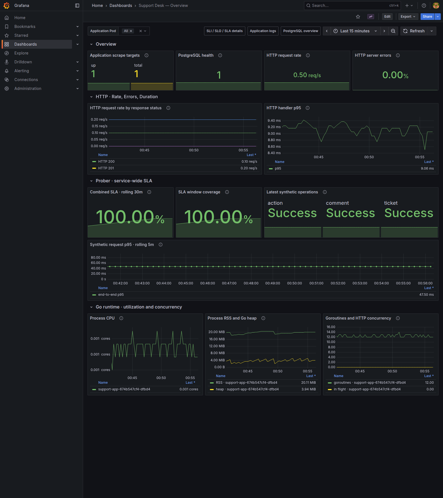
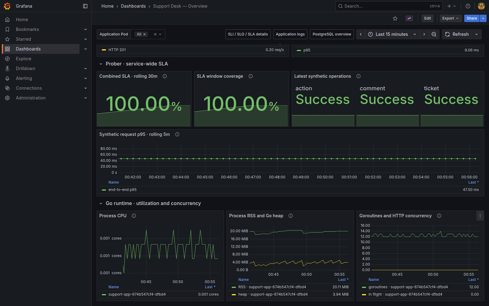
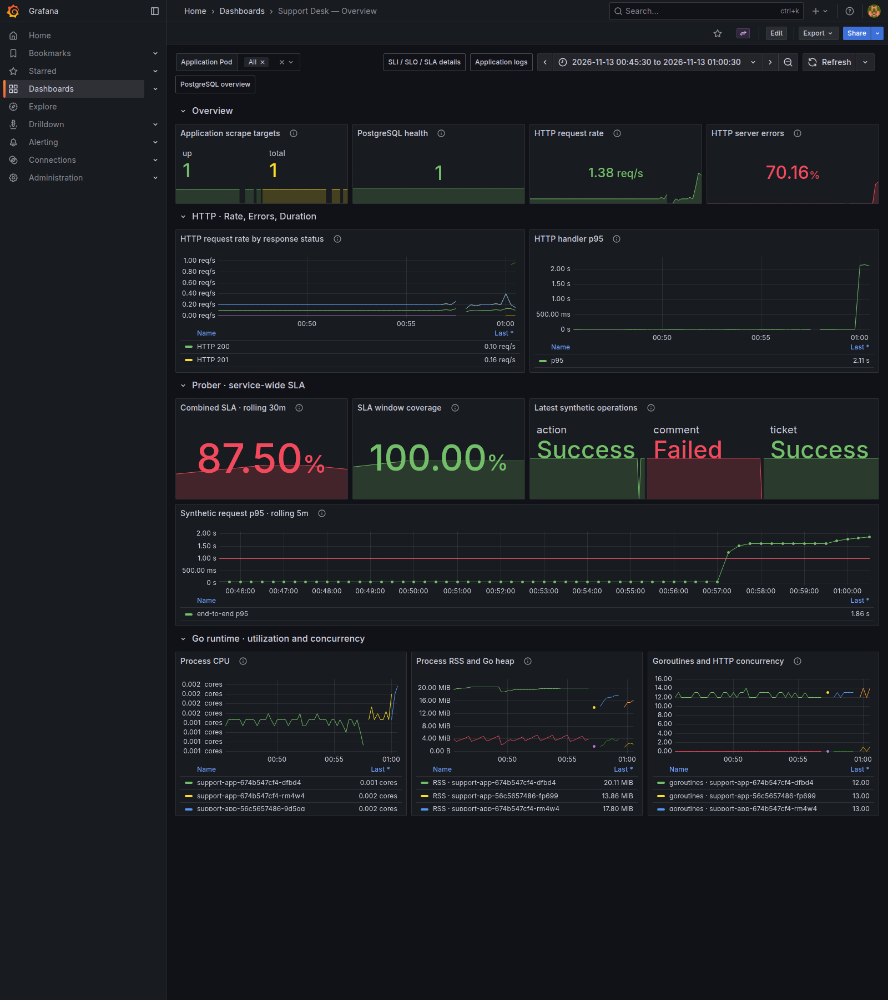
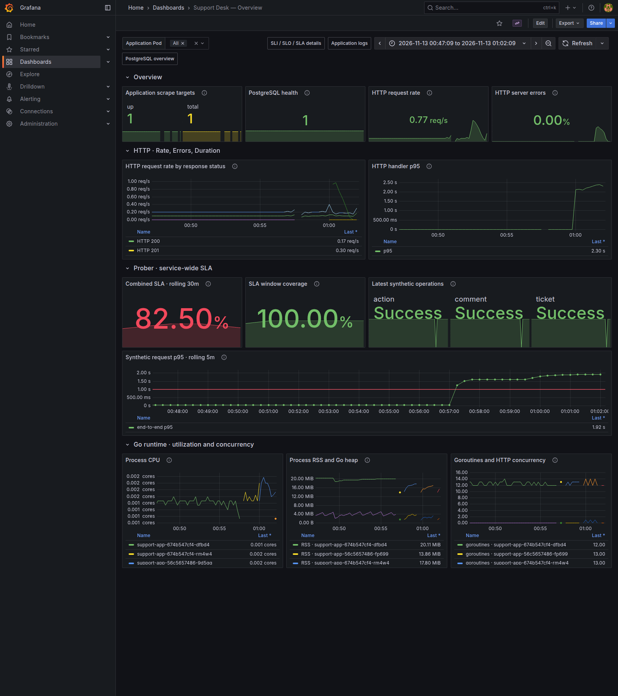
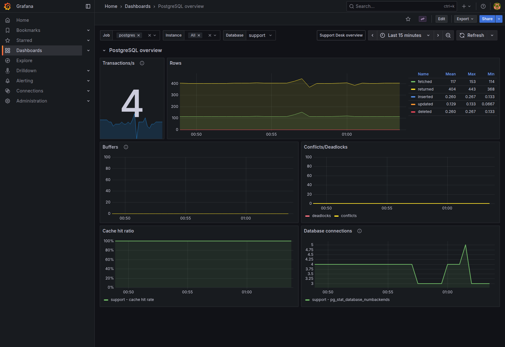

# Визуализация Support Desk в Grafana

## Источники данных

Все новые панели используют **VictoriaMetrics** через
встроенный Prometheus datasource. VictoriaMetrics опрашивает Pod каждые 15 секунд: приложение на 9090,
PostgreSQL Exporter на 9187, пробер на 9115.

## Выбор панелей

| Панели                             | Метрики                                                                                      | Зачем                                                                                                     |
|------------------------------------|----------------------------------------------------------------------------------------------|-----------------------------------------------------------------------------------------------------------|
| Доступность приложения и БД        | `up`, `pg_up`                                                                                | Сопоставить число доступных scrape-таргетов с общим числом; отдельно проверить соединение экспортера с БД |
| RPS и коды HTTP                    | `support_http_requests_total`                                                                | Показать нагрузку и различить успешные ответы, клиентские отказы и серверные ошибки                       |
| HTTP p95                           | `support_http_request_duration_seconds_bucket`                                               | Обнаружить рост длительности обработки запросов                                                           |
| SLA и покрытие окна                | Формулы SLA/coverage из предыдущей работы                                                    | Сопоставить качество сервиса с целью 99% и убедиться, что окно наблюдений заполнено                       |
| Результат операций и synthetic p95 | `support_probe_success`, `support_probe_duration_seconds_bucket`                             | Увидеть доступность пользовательских сценариев и сквозную задержку                                        |
| CPU, RSS, heap                     | `process_cpu_seconds_total`, `process_resident_memory_bytes`, `go_memstats_heap_alloc_bytes` | Оценить использование ресурсов каждого экземпляра                                                         |
| Goroutines и запросы в работе      | `go_goroutines`, `support_http_requests_in_flight`                                           | Найти накопление параллельной работы при росте нагрузки или задержек                                      |

Верхняя строка содержит Stat-панели для быстрой оценки состояния. Ниже идут
HTTP RED, пробер/SLA и детализация runtime. Time series показывают динамику и
помогают сопоставить начало деградации с нагрузкой. Единицы заданы явно:
запросы/сек, секунды, проценты, байты и CPU cores. У synthetic p95 отмечен порог
1 секунда; у SLA — 99%. Порог 1% для HTTP 5xx служит визуальным ориентиром.

Такое расположение отражает RED: Rate, Errors, Duration. Из Golden Signals
показаны трафик, ошибки, задержка и параллельная работа как индикатор насыщения.
Из USE используются загрузка CPU/памяти и диагностика ошибок/накопления запросов.
Goroutines и in-flight не выдаются за процент заполнения очереди.

Переменная **Application Pod** фильтрует HTTP/runtime, по умолчанию выбраны все
экземпляры. Скорости вычисляются до суммирования реплик; p95 — после объединения
bucket по `le`. Источники SLA и PostgreSQL остаются общими для сервиса.
HTTP-метрики включают API и демонстрационный `/debug/error`, но исключают
health-check, статику и scrape. Метки содержат шаблоны маршрутов, а не ID или
параметры запросов. При отсутствии трафика доля 5xx не превращается в 100% успеха.

## SLA пробера

Панель **Combined SLA - rolling 30m** использует прежнюю формулу без изменения
целей. Это доля хороших 15-секундных интервалов за 30 минут: все три бизнес-SLI
не ниже 99%, p95 меньше 1 секунды, пробер свежий, все три последних
операции успешны, scrape приложения и пробера доступен.

Рядом показано покрытие окна. Пропуски и устаревшие наблюдения учитываются как плохие интервалы.
Переключение Application Pod не меняет SLA.

Для демонстрации использованы существующие `LAB_FAULT_RATE=0.20` и
`LAB_FAULT_DELAY=1.5s`; дополнительные ответы 500 получены через `/debug/error`.
Это даёт наглядные изменения HTTP-ошибок и задержки без изменения целей SLA.

После демонстрации обе настройки возвращены к нулю. Последние операции пробера
снова успешны. Пятиминутные SLI/p95 и SLA за 30 минут продолжают учитывать
исторические ошибки, поэтому не обязаны восстановиться одновременно с последним
успешным запросом.

## PostgreSQL Exporter

Импортирован [дашборд из тега postgres_exporter v0.20.1](https://github.com/prometheus-community/postgres_exporter/blob/v0.20.1/postgres_mixin/dashboards/postgres-overview.json),
соответствующего установленному exporter. Выбран источник VictoriaMetrics,
`job=postgres`, база `support`. Панели показывают транзакции/сек, работу со
строками, буферы, конфликты/deadlocks, cache hit ratio и соединения.

